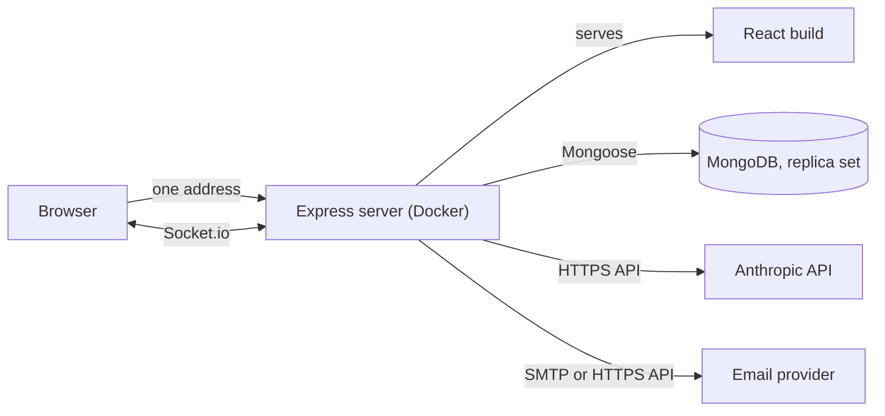
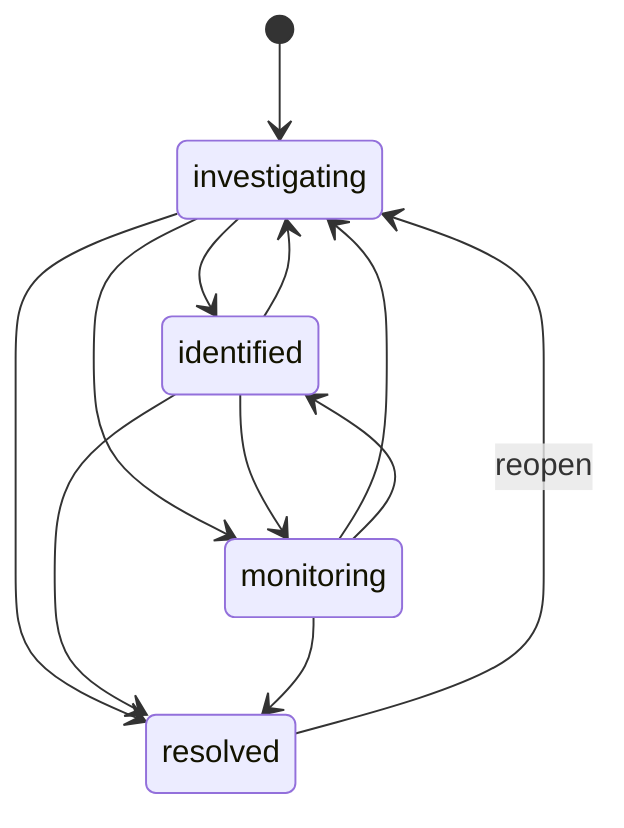

# Smart Incident Response Platform

A multi-tenant platform for handling production outages. Teams open incidents, assign responders, post live updates, and keep an audit trail. Customers see a public status page, and an AI drafts the postmortem once the incident is resolved. A human reviews and publishes it.

**Live demo:** `TODO: add your Render URL`
(The demo runs on a free host, so the first visit after a quiet period can take about a minute to wake up.)

<!-- TODO: add 3-4 screenshots in docs/screenshots and link them here:


-->

## Contents

- [What it does](#what-it-does)
- [Tech stack](#tech-stack)
- [Architecture](#architecture)
- [Key design decisions](#key-design-decisions)
- [Roles and permissions](#roles-and-permissions)
- [API overview](#api-overview)
- [Real-time events](#real-time-events)
- [Running it locally](#running-it-locally)
- [Environment variables](#environment-variables)
- [Testing](#testing)
- [Deployment](#deployment)
- [Known limitations](#known-limitations)

## What it does

**For the team (login required)**
- Sign up with a company name, and invite teammates by email with a role.
- Define the services you run, such as "Payments API".
- Open an incident with a severity and an affected service. The service status updates automatically.
- Move the incident through its lifecycle. Invalid moves are rejected by a state machine.
- Assign responders, post notes, and watch every change appear live on everyone's screen.
- Every action is saved to an append-only timeline that records who did what, and when.
- After resolution, generate a postmortem draft with AI, edit it, and publish it (admin only).

**For customers (no login)**
- A public status page per company at `/status/<company-slug>` shows service health and the updates the team chose to publish. It updates by itself.

**Account basics**
- Email invitations, password reset by email link, and logout.

## Tech stack

| Area | Technology |
|---|---|
| Frontend | React, TypeScript, Vite |
| Backend | Node.js, Express 5, TypeScript |
| Database | MongoDB with Mongoose (transactions) |
| Real time | Socket.io |
| Auth | JWT in an `httpOnly` cookie, bcrypt |
| AI | Anthropic API (postmortem drafts) |
| Email | Nodemailer (SMTP) or the Brevo HTTPS API |
| Validation and limits | express-validator, express-rate-limit |
| Tests | Vitest, Supertest, socket.io-client |
| Packaging | Docker, Docker Compose |
| Hosting (demo) | Render (free), MongoDB Atlas (free), Brevo (free) |

## Architecture



The server serves the React build, the REST API, and the Socket.io connection from a single address. That is deliberate, and the reasons are in the design decisions below.

**Project layout (roughly)**

```
Backend/
  src/
    models/        Mongoose schemas
    services/      business logic (no HTTP, easy to test)
    controllers/   thin HTTP handlers
    routes/        route definitions and middleware order
    middleware/    auth, role checks, error handler
    validators/    express-validator rules
    realtime/      Socket.io setup and broadcasting
    utils/         cookie and session helpers
    types/         shared types and value lists
    tests/         unit and integration tests
Frontend/          React app
Dockerfile         one image: builds the React app and the server
docker-compose.yml local setup: MongoDB replica set, server, nginx
```

## Key design decisions

### Multi-tenancy
- Every tenant-owned document carries an `organizationId`, and every query filters by it.
- The `organizationId` always comes from the verified login token, never from the request body. A request that sends someone else's id is ignored.
- Asking for another company's data returns **404, not 403**, so the response never confirms that something exists.
- Isolation is tested automatically, over both HTTP and sockets (see [Testing](#testing)).

### Users and memberships are separate
- A `User` is an identity (name, email, password). A `Membership` links a user to an organization and carries the role.
- One person can belong to several organizations, each with a different role. The login flow currently picks one membership, which is a known simplification.

### Incident state machine
Incident status is a state machine. The allowed moves are stored as data, and a pure function checks them.



- Skipping ahead to `resolved` is allowed (a quick fix). Moving backward is allowed (the problem came back).
- A resolved incident can only be reopened, and it goes back to `investigating`.
- Moving to the same status is rejected.
- A change is applied with the expected current status in the update filter. If someone else changed it first, the update fails with 409 instead of silently overwriting.

### Transactions
Operations that touch several documents run in a MongoDB transaction, so they succeed or fail together:
- **Register:** organization, user, and membership.
- **Create incident:** the incident, its first timeline entry, and the service status.
- **Change status:** the incident, the timeline entry, and the service status. A service returns to `operational` only when it has no other unresolved incidents.
- **Accept invitation** and **reset password:** claiming the secret link and changing the data.

### Append-only timeline
Every status change, assignment, and note becomes a timeline entry with structured fields (type, from and to status, target user). The timeline is never edited, so it works as an audit trail and gives the AI clean input.

### AI postmortem: the AI drafts, a human decides
- Only resolved incidents can be drafted. The draft is saved with `status: draft`.
- Responders and admins can edit it. **Only an admin can publish it**, and the approver and time are recorded. A published postmortem is locked.
- The prompt tells the model to use only facts from the timeline and to write "Not determined from the timeline" when the cause isn't stated.
- User-written timeline text is wrapped in data tags, and the prompt says never to follow instructions found inside it (prompt-injection defense).
- The server computes the incident duration, because models are unreliable at date arithmetic.
- The model's answer must be JSON. It is parsed and cleaned, and only the expected fields are kept. If the AI is down or returns garbage, the endpoint returns 502 and saves nothing.
- The slow AI call happens outside any database transaction.

### Public status page
- A separate endpoint with no login, found by the organization's slug.
- The response is built by hand, field by field. Internal ids, assignees, descriptions, and internal notes never appear.
- An incident shows publicly only after someone posts at least one `public` update on it. Updates default to `internal`, so nothing is published by accident.
- The same function builds the page response and the live snapshot, so the two can never disagree.

### Real time
- **Internal line:** the socket connection is authenticated with the same login cookie. Each organization has its own room, and the room comes from the verified token. A client can't ask to join another room.
- **Public line (`/public`):** no login. A visitor can only subscribe to a status page by its slug, and receives the same sanitized snapshot as the REST page. Updates within 500 ms are merged into one snapshot, and no work is done when nobody is watching.

### Secrets and sessions
- Passwords are hashed with bcrypt.
- Invitation and reset links contain a random secret. Only its SHA-256 fingerprint is stored.
- Invitation and reset links are single-use and expire (7 days and 60 minutes). Claiming a link is an atomic update, so two simultaneous clicks cannot both succeed.
- After a password reset, older logins stop working: each request compares the token's issue time with the user's `passwordChangedAt`.
- Login and forgot-password answers never reveal whether an email is registered.
- Emailed links are built from the `CLIENT_URL` setting, never from the request's `Host` header, which prevents host-header poisoning of reset emails.

### Email
- One small mailer sends through the Brevo HTTPS API when a key is set, through SMTP otherwise, or prints to the console when nothing is configured.
- A failed email never undoes the action that triggered it. The invitation is saved first, and the response reports `emailSent: true | false`, with the link as a fallback for the admin.
- User-provided text is HTML-escaped in emails, and line breaks are removed from subjects.
- Sending is rate limited to protect the mailbox from abuse.

## Roles and permissions

| Action | Admin | Responder | Viewer |
|---|:---:|:---:|:---:|
| View incidents, services, members, timeline | yes | yes | yes |
| Open incidents, change status, assign, post notes | yes | yes | no |
| Draft and edit postmortems | yes | yes | no |
| Publish postmortems | yes | no | no |
| Create services | yes | no | no |
| Invite, resend, or revoke invitations | yes | no | no |

## API overview

Base path: `/api/v1`. Authenticated routes use the `token` cookie.

**Auth**
| Method and path | Purpose |
|---|---|
| `POST /auth/register` | Create an organization and its first admin, and log in |
| `POST /auth/login` | Log in |
| `POST /auth/logout` | Clear the cookie |
| `GET /auth/me` | Current user, organization, and role |
| `POST /auth/forgot-password` | Email a reset link (always the same response) |
| `POST /auth/reset-password` | Choose a new password with a reset link |

**Services, members, invitations**
| Method and path | Purpose |
|---|---|
| `GET /services`, `POST /services` | List services, create a service (admin) |
| `GET /members` | List the organization's members |
| `POST /invitations` | Invite someone by email with a role (admin) |
| `GET /invitations`, `DELETE /invitations/:id` | List pending, revoke (admin) |
| `POST /invitations/:id/resend` | Issue a new link and email it (admin) |
| `POST /invitations/accept` | Accept an invitation (public) |

**Incidents**
| Method and path | Purpose |
|---|---|
| `POST /incidents`, `GET /incidents`, `GET /incidents/:id` | Create, list, read with the timeline |
| `PATCH /incidents/:id/status` | Change status (validated by the state machine) |
| `POST /incidents/:id/assign`, `DELETE /incidents/:id/assign/:userId` | Assign or unassign a responder |
| `POST /incidents/:id/updates` | Post a note (`internal` or `public`) |
| `POST /incidents/:id/postmortem/draft` | Generate an AI draft (resolved incidents only) |
| `GET`, `PATCH /incidents/:id/postmortem` | Read or edit the draft |
| `POST /incidents/:id/postmortem/publish` | Publish (admin) |

**Public and health**
| Method and path | Purpose |
|---|---|
| `GET /status/:slug` | Public status page data |
| `GET /health` | Reports whether the database is reachable |

Errors always use the same shape: `{ "success": false, "message": "..." }`.

## Real-time events

| Event | Where | Meaning |
|---|---|---|
| `incident:created` | internal line | A new incident was opened |
| `incident:updated` | internal line | Status or assignment changed |
| `incident:note` | internal line | A note was posted |
| `subscribe` (client to server) | `/public` | Watch a status page by slug (acknowledged with the current snapshot) |
| `status:snapshot` | `/public` | A fresh sanitized snapshot of the status page |

## Running it locally

### With Docker Compose (recommended)

Requires Docker. This starts MongoDB as a replica set (transactions need one), the server, and nginx.

```bash
cp .env.example .env      # then fill in JWT_SECRET and any optional keys
docker compose up --build
```

Open <http://localhost:8080>.

```bash
docker compose logs -f server   # server logs
docker compose down             # stop, keep the data
docker compose down -v          # stop and delete the database
```

### Without Docker

You need a MongoDB **replica set** (a free Atlas cluster works, or run one locally).

```bash
# backend
cd Backend
cp .env.example .env      # fill in MONGO_URI and JWT_SECRET
npm install
npm run dev               # http://localhost:5000

# frontend, in a second terminal
cd Frontend
npm install
npm run dev               # http://localhost:5173, proxies /api and /socket.io to the backend
```

The frontend always calls relative paths (`/api/v1/...`), and the Vite proxy makes the dev setup behave like production: one site, so the strict login cookie works.

## Environment variables

| Variable | Required | Purpose |
|---|---|---|
| `MONGO_URI` | yes | MongoDB connection string (must be a replica set) |
| `JWT_SECRET` | yes | Secret used to sign login tokens |
| `CLIENT_URL` | yes | Public address of the app. Used in emailed links and socket CORS |
| `PORT` | no | Server port (hosts like Render set it themselves) |
| `NODE_ENV` | no | `production` turns on secure cookies |
| `COOKIE_SECURE` | no | Overrides the secure-cookie setting (`false` for plain-http local Docker) |
| `TRUST_PROXY_HOPS` | no | Number of proxies in front of the server (`1` behind nginx or Render) |
| `SERVE_CLIENT` | no | `true` makes Express serve the React build |
| `ANTHROPIC_API_KEY` | for AI | Postmortem drafts |
| `ANTHROPIC_MODEL` | no | Model name for drafts (a default is built in) |
| `BREVO_API_KEY` | for email | Send email over HTTPS (used when set) |
| `SMTP_HOST`, `SMTP_PORT`, `SMTP_USER`, `SMTP_PASS` | for email | SMTP alternative, for example Gmail with an app password |
| `MAIL_FROM` | for email | Sender, such as `"Incident Platform <you@example.com>"` |
| `MONGO_TEST_URI` | for tests | Test database. Its name must contain "test" |

With no email settings, emails are printed to the server console, so the app works without any email account.

## Testing

```bash
cd Backend
npm test            # run everything once
npm run test:watch  # re-run on save
```

Tests need a MongoDB replica set. The simplest local one:

```bash
docker run -d --name mongo-test -p 27018:27018 mongo:7 --replSet rs0 --port 27018 --bind_ip_all
docker exec mongo-test mongosh --port 27018 --eval 'rs.initiate({_id:"rs0", members:[{_id:0, host:"localhost:27018"}]})'
```

and `MONGO_TEST_URI=mongodb://localhost:27018/incident-response-test?replicaSet=rs0`.

The test helpers clear every collection before each test, so they refuse to run unless the database name contains `test`.

**What is covered**
- **Unit tests:** the incident state machine (allowed moves, forbidden moves, no self-transitions, no dead ends), slug generation, and the invitation email text (HTML escaping, subject safety).
- **Multi-tenant isolation over HTTP:** a second company cannot read, change, assign, post to, or draft a postmortem on another company's data, and every attempt is also checked in the database. A forged `organizationId` in the body is ignored, and the public page leaks no internal data.
- **Multi-tenant isolation over sockets:** another company receives no events at all, and the public line stays silent for other companies.
- **Roles:** viewers can read but never write, and responders cannot create services or publish postmortems.
- **Register rollback:** if any step fails, nothing is saved, and the same signup works afterwards.
- **AI flow with a fake model:** parsing and cleaning of answers, a provider outage, garbage output, no AI call for refused requests, and the draft, edit, publish, and lock flow.
- **Email and invitations:** sending, resending (the old link stops working), and cross-company resend refused.
- **Password reset and sessions:** the same answer for known and unknown emails, single-use and expiring links, and old logins stopping after a change.

Tests that need a "positive control" first prove that the owner can use their own data, so a wrong URL can never make an isolation test pass for the wrong reason.

## Deployment

The demo runs entirely on free tiers.

```
Browser -> Render (one Docker container: React build + API + Socket.io) -> MongoDB Atlas (M0)
                                                                        -> Brevo email API
                                                                        -> Anthropic API
```

**Why it is built this way**
- **One service for frontend and backend.** The login cookie is `sameSite: "strict"`, which browsers only send to the site that set it. Serving everything from one address avoids cross-site cookie and CORS problems, and sockets use the same address.
- **Docker.** The same image runs locally and in production.
- **Atlas for the data.** Free web hosts have temporary disks that are wiped on restart, and Atlas is already a replica set, so transactions work.
- **Email over HTTPS.** Free Render services block outbound SMTP ports, so the mailer uses Brevo's HTTPS API when `BREVO_API_KEY` is set.
- **Settings in environment variables.** No secrets are in the code or the image.

**Steps**
1. Create a free Atlas M0 cluster and a database user, allow network access, and copy the connection string.
2. Create a Brevo account, verify a sender address, and create an API key.
3. Push the repo to GitHub (never commit `.env`).
4. In Render, create a **Web Service** from the repo with runtime **Docker** and the **Free** instance type. Leave the root directory empty.
5. Set the environment variables: `MONGO_URI`, `JWT_SECRET` (a new one), `CLIENT_URL` (the Render address, no trailing slash), `TRUST_PROXY_HOPS=1`, `SERVE_CLIENT=true`, `BREVO_API_KEY`, `MAIL_FROM`, and `ANTHROPIC_API_KEY`.
6. Set the health check path to `/api/v1/health` and deploy.

**On a server you control**, the same Compose file works behind a reverse proxy such as Caddy, which also removes the sleeping behavior of free hosting.

## Known limitations

- **Free hosting sleeps.** After about 15 minutes without traffic, the first request takes around a minute.
- **One server instance.** Live-update rooms and rate-limit counters live in process memory. Running several instances would need Socket.io's Redis adapter and a shared rate-limit store.
- **Login picks one membership.** The data model supports several organizations per user, but login takes one. A chooser at login is the natural next step.
- **Roles live in the token.** A role change takes effect at the next login. The password-reset check ends old sessions, but there is no "log out everywhere" button, and tokens can't be revoked one by one.
- **Sockets check the token once.** A connection stays open until it closes, even if the token later expires.
- **Free database limits.** A small free Atlas cluster, probably with no automatic backups. Run `mongodump` occasionally.
- **No background queue.** Emails are sent inside the request. A queue (for example BullMQ with Redis) would make slow mail servers invisible to users.
- **The AI draft is only as good as the timeline.** It is told not to guess, but a human review is part of the design for that reason.

## Author

Built by Rohit ([@Rohit-Dhade](https://github.com/Rohit-Dhade)) as an end-to-end project covering multi-tenant architecture, real-time systems, transactions, an AI-assisted workflow, testing, and deployment.

